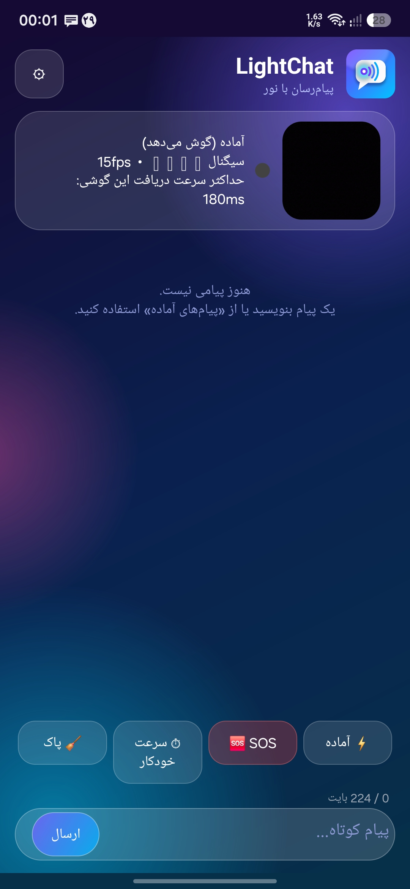

# LightChat — پیام‌رسان با چراغ قوه و دوربین

دو گوشی اندروید با **چشمک چراغ قوه** (فرستنده) و **دوربین عقب** (گیرنده) به هم پیام می‌دهند. بدون اینترنت، بلوتوث، وای‌فای یا شبکه‌ی موبایل.

<p align="center"></p>

> **English:** LightChat is an Android messenger that sends text between phones by blinking the flashlight and reading it with the rear camera. No internet, Bluetooth or Wi-Fi. Kotlin + CameraX, no server. Features: live (chunked) text, CRC-16 + selective-repeat ARQ, optional AES-128 password, Persian-compact text, SOS mode, group messaging. **Status: experimental; verified only in a software simulator, not yet on real phones. Needs line of sight; do not rely on it as the only emergency channel.**

## ویژگی‌ها
نمایش زنده‌ی پیام • ارسال مجدد انتخابی با CRC • رمز اختیاری • متن فارسی فشرده • SOS • گروهی • رابط شیشه‌ای • عیب‌یابی (روی کارت وضعیت بزن)

## ساختار پروژه
```
app/src/main/java/com/lightchat/core/   منطق خالص Kotlin (فریم، دیکودر، پیام، رمز) - قابل تست روی JVM
app/src/main/java/com/lightchat/MainActivity.kt   رابط کاربری، دوربین، چراغ
tools/                                  شبیه‌ساز و تست‌ها
docs/screenshot.jpg                     تصویر محیط برنامه
install.bat                             ساخت خودکار در ویندوز
```

## ساخت و اجرا
- روی ویندوز: `install.bat` را اجرا کن (JDK و Android SDK را چک می‌کند، `local.properties` می‌سازد و APK را می‌سازد؛ اگر خطای دانلود داد VPN روشن کن).
- یا در Android Studio: Open ← پوشه‌ی `LightChat` ← Sync ← Run.
- APK: `app/build/outputs/apk/debug/app-debug.apk` را روی **دو گوشی** نصب کن و اجازه‌ی دوربین بده.

## استفاده
- دو گوشی **پشت‌به‌پشت و رو‌به‌روی هم** (۲۰ تا ۵۰ سانتی‌متر) تا چراغ هر کدام به دوربین عقب دیگری بتابد. چراغ گوشی مقابل باید در پیش‌نمایش بالای صفحه دیده شود؛ چراغ کوچک کنار وضعیت با هر چشمک روشن می‌شود.
- اپ باید روی صفحه باشد (صفحه خودکار خاموش نمی‌شود). محیط تاریک‌تر و بدون نور چشمک‌زن بهتر است.

## تازه‌ها
- **نمایش زنده:** پیام تکه‌تکه (چانک ۸ بایتی) فرستاده می‌شود و گیرنده هر تکه را همان لحظه‌ای که CRC آن درست بود نشان می‌دهد (با «…» تا کامل شدن). دیگر منتظر کل پیام نمی‌ماند.
- **دقت بالاتر:** دیکودر آنلاین با ردیابی ساعت، CRC-16 برای هر تکه، هدر با بیت‌های کنترلی، و **ارسال مجدد انتخابی**: گیرنده بعد از هر ارسال یک ACK با ماسک تکه‌های رسیده می‌فرستد و فرستنده فقط تکه‌های گم‌شده را دوباره می‌فرستد (تا ۶ تلاش، با کند شدن خودکار).
- **متن فشرده:** حروف فارسی ۱ بایت (نه ۲) → زمان ارسال متن فارسی تقریباً نصف.
- **نسخه‌ی ۳ (سریع‌تر و مقاوم‌تر):** کدگذاری خط جدید (NRZI + بیت‌استافینگ) حدود ۰٫۹ بیت در هر اسلات به‌جای ۰٫۵ (Manchester) ← حدود ۱٫۷ برابر سریع‌تر در همان سرعت چراغ. **نشانه‌ی همگام‌سازی قبل از هر تکه**: خرابی یک تکه فقط همان تکه را از بین می‌برد و ساعت گیرنده برای تکه‌ی بعد دوباره تنظیم می‌شود؛ باقی پیام با ارسال مجدد انتخابی کامل می‌شود. ACK و زمان‌های انتظار کوتاه‌تر شدند.
- **گروهی (چند نفره):** هر گوشی یک شناسه دارد، پیام می‌تواند برای همه یا یک نفر باشد، ACK نوبتی؛ ⚙ → 👥. توجه: دوربین هر عضو باید چراغ فرستنده را ببیند.
- **عیب‌یابی:** روی کارت وضعیت (بالا) بزن تا فریم‌ریت، کنتراست، تعداد تکه‌های سالم/خراب و همگام‌سازی‌های مجدد را ببینی.
- **سرعت خودکار:** پیش‌فرض از ۱۳۰ms شروع می‌کند و بعد از ارسال‌های تمیز بالا می‌رود، بعد از مشکل پایین می‌آید. هر گوشی حداکثر سرعت دریافت خودش را (از فریم‌ریت دوربین) در ACK اعلام می‌کند. سرعت دستی: ۱۶۰ / ۱۳۰ / ۱۰۰ / ۷۵ / ۵۵ms (هر اسلات).
- **پیام‌های آماده:** SOS، سالم‌ام، مجروح داریم، آب و غذا، خطر، منتظر بمانید، دریافت شد، تکرار کنید، بله، نه.
- **SOS:** چشمک مورس SOS (برای چشم انسان) و بعد پیام SOS برای گوشی مقابل، تکرارشونده تا زمانی که «توقف SOS» را بزنی. پیام SOS دریافتی قرمز نشان داده می‌شود.
- **رمزنگاری اختیاری (پیش‌فرض خاموش):** در ⚙ تنظیمات یک رمز مشترک بگذار؛ رمز می‌تواند حروف فارسی/انگلیسی، عدد و علامت باشد (AES-128-CTR با کلید PBKDF2؛ فقط ۲ بایت اضافه برای هر پیام). خالی بگذاری، پیام‌ها بدون رمز می‌روند.
- **ظاهر جدید:** رابط شیشه‌ای (glassmorphism) با پس‌زمینه‌ی گرادیان و لکه‌های رنگی، لوگوی جدید (آیکن برنامه و هدر)، راهنمای شروع در اولین اجرا، دکمه‌های بزرگ و خوانا.
- لرزش هنگام دریافت، نمایش کیفیت سیگنال و فریم‌ریت، دکمه‌ی پاک کردن گفتگو (چیزی ذخیره نمی‌شود)، گزینه‌ی درخواست ۶۰ فریم بر ثانیه.

## سرعت واقعی (مهم)
نور کند است، این فیزیک کانال است نه باگ. با دوربین ۳۰fps سرعت خودکار تا ۱۰۰ms/اسلات می‌رود (دوربین ۳۰fps):
- یک پیام فارسی ۲۰ حرفی ≈ ۲۰ بایت ← حدود ۲۰–۲۵ ثانیه (برآورد از شبیه‌ساز، نه گوشی واقعی).
- با دوربین ۶۰fps حدود دو برابر سریع‌تر.
- بالای صفحه تخمین زمان هر پیام نوشته می‌شود. بیشینه‌ی طول پیام ۲۲۴ بایت است.

## درباره‌ی استفاده در شرایط اضطراری
- روی گوشی واقعی من تست نشده؛ منطق پروتکل با شبیه‌ساز دوربین تست شده (پایین). قبل از اتکا، آن را با دو گوشی خودت در همان شرایط (فاصله، نور، زاویه) امتحان کن.
- نیاز به **دید مستقیم** دو گوشی، باتری و صفحه‌ی روشن دارد؛ نور چراغ را هر کسی که در دید است می‌بیند. رمزنگاری فقط محتوا را از ناظر پنهان می‌کند، نه وجود نور را، و فرستنده را احراز هویت نمی‌کند.
- برای کمک واقعی، تنها راه ارتباطی نباش: سوت، علامت دست، رادیو، یا پیام‌رسان‌های آفلاین/مش را هم کنارش داشته باش.

## پروتکل (خلاصه)
- فریم: `[هدر: نوع ۲بیت + طول ۴بیت + کنترل ۲بیت][داده ≤۱۵ بایت][CRC-16]`. داده‌ی چانک: `[meta: شناسه‌ی پیام ۲بیت، آخرین، رمزشده، شماره‌ی تکه ۴بیت][متن]`.
- یک ارسال = ۶ پالس مقدمه، سپس برای هر فریم: نشانه‌ی ۷ اسلات روشن + بیت شروع + بیت‌های NRZI با استافینگ (بعد از ۳ صفر یک ۱ اضافه). ۹ اسلات بدون تغییر = پایان ارسال.
- گیرنده: آستانه‌ی تطبیقی، لبه‌ها با دقت زیر-فریم، ردیابی ساعت، تشخیص سرعت از مقدمه، دیکود زنده‌ی بیت‌به‌بیت.

## تست منطق (بدون گوشی)
منطق کد Kotlin خالص است:
```
KOTLINC=/path/to/kotlinc tools/run-sim.sh
```
شامل: تست CRC و فریم، رمزنگاری، کدک متن، assembler، شبیه‌ساز دوربین (۲۴ تا ۶۰ فریم بر ثانیه، نویز، لرزش چراغ)، عدم تشخیص اشتباه روی نویز/چشمک تصادفی، و ارسال کامل پیام با ارسال مجدد انتخابی. نتیجه: در سرعت‌های پشتیبانی‌شده‌ی هر نرخ فریم همه‌ی پیام‌ها رسیدند؛ در حالت سخت (لرزش ±۲۵ms، نویز زیاد) میانگین ۱.۲ دور ارسال لازم شد.

## ارتباط با ما / Follow
<p align="center">
  <a href="https://www.instagram.com/windroida"></a>
  <a href="https://t.me/windroida"></a>
  <a href="https://youtube.com/@windroida"></a>
</p>

- Instagram: https://www.instagram.com/windroida
- Telegram: https://t.me/windroida
- YouTube: https://youtube.com/@windroida
